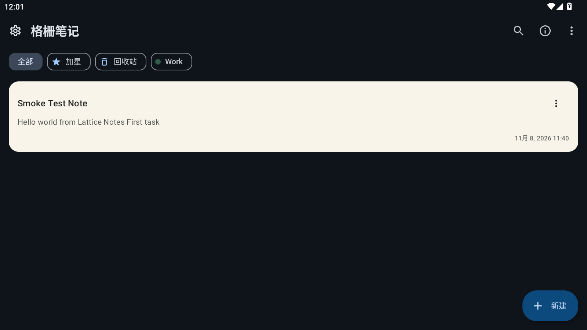
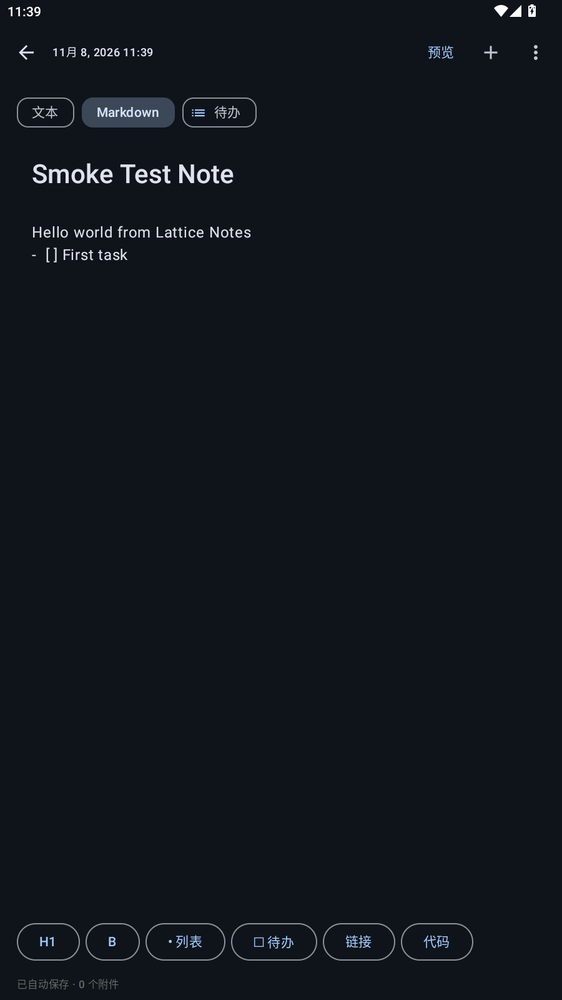

# Lattice Notes

Lattice Notes 是一个原创、本地优先、无广告的 Android 开源笔记应用。项目采用 Kotlin、Jetpack Compose、Room 和 Material 3。

> 本项目没有复制 Smartisan Notes 的代码、资源、品牌或第三方 SDK。功能设计仅参考通用笔记应用需求与公开可见的交互行为。

## 截图

| 笔记列表 | Markdown 编辑器 |
| --- | --- |
|  |  |

## 功能

- 普通文本、Markdown、待办三种便签模式
- 标题、正文、标签、文件夹和自动保存
- 全部、加星、文件夹、回收站视图
- 置顶、加星、软删除、恢复和永久删除
- 标题与正文搜索，本地知识检索
- 图片及任意文档附件
- 笔记提醒与系统通知
- 文本分享和长图分享
- PIN 应用锁
- 浅色/深色/跟随系统主题
- 动态取色、字号缩放
- JSON 备份与恢复
- 从其他应用接收纯文本分享
- 主屏幕快捷方式：新建便签、搜索

## 构建

环境要求：

- JDK 21
- Android SDK Platform 34
- Android Build-Tools 34.0.0 或更新版本

```bash
./gradlew assembleDebug
```

调试 APK 输出：

```text
app/build/outputs/apk/debug/app-debug.apk
```

单元测试：

```bash
./gradlew testDebugUnitTest
```

## 数据与隐私

- 笔记默认仅保存在应用私有数据库。
- 应用不含广告、遥测或账号 SDK。
- 导出操作由 Android 系统文件选择器授权。
- PIN 以带随机盐的 PBKDF2 哈希保存，不保存明文。
- 附件复制到应用私有目录，不请求宽泛存储权限。

## 发布签名

仓库不包含发布证书。请自行生成并安全保管 keystore，再通过 `KEYSTORE_FILE`、`KEYSTORE_PASSWORD`、`KEY_ALIAS`、`KEY_PASSWORD` 环境变量配置签名。正式发布前还应执行：

```bash
./gradlew lintDebug testDebugUnitTest assembleRelease
```

当前 Release 产物为未签名包；GitHub Actions 默认构建可安装的 Debug APK。

## 当前边界

首版没有内置云账号、付费服务或远程 AI。知识检索在设备本地执行；后续可通过独立适配器接入 WebDAV、用户自有服务器或兼容 OpenAI API 的服务。详见 [功能对照](docs/FEATURE_PARITY.md)。

## 许可证

[MIT](LICENSE)
