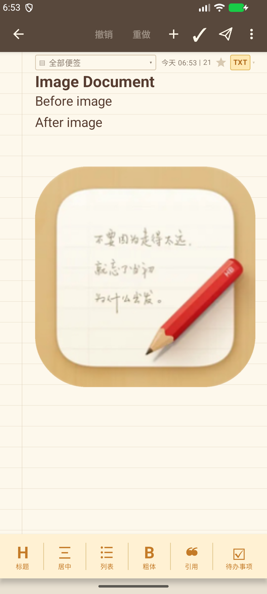

# 曲阳便签

曲阳便签是一个原创、本地优先、无广告的 Android 开源笔记应用。项目采用 Kotlin、Jetpack Compose、Room 和 Material 3。

> 本项目没有复制 Smartisan Notes 的代码、资源、品牌或第三方 SDK。功能设计仅参考通用笔记应用需求与公开可见的交互行为。

## 截图

| 分类菜单 | 信纸编辑器 |
| --- | --- |
|  |  |

## 功能

- 普通文本、Markdown、待办三种便签模式
- 标题、正文、标签、文件夹和自动保存
- 主页固定搜索框
- 编辑器撤销/重做历史
- 顶部分类菜单：全部、加星、文件夹、回收站及实时数量
- 置顶、加星、软删除、恢复和永久删除
- 标题与正文搜索，本地知识检索
- 图片可直接嵌入便签正文，并随文档预览和导出
- 任意文档附件
- 图片附件可嵌入 Markdown 记事和单文件 HTML
- 内置 OAF Office 编辑器，可离线打开、编辑并原位保存 docx/xlsx，不依赖 WPS 或 Microsoft 365
- 导出正文、图片和内置图标合并的单文件 HTML
- 密码加密的完整备份：记事、文件夹、提醒、图片和附件统一导出为 `.qbak`
- 直接批量导入 `.md` 文件
- WebDAV 前台每 30 秒自动同步，每篇记事保存为独立的 Markdown 文件
- 自动创建「曲阳便签」WebDAV 专用目录，支持批量同步几十个 Markdown 文件
- Obsidian 式三方同步：本地、远端和上次记录对比，支持冲突与删除传播
- 超过一半的批量删除会被自动拦截，避免 WebDAV 异常导致本地笔记全部丢失
- GitHub Release 在线更新：每天自动检查，校验 SHA-256 与签名后打开系统安装界面
- 笔记提醒与系统通知
- 飞机按钮操作面板：复制文字、文字分享、图片分享、发送邮件
- PIN 应用锁
- 浅色/深色/跟随系统主题
- 暖棕/米黄主题、字号缩放
- Markdown 文件导入与恢复
- 从其他应用接收纯文本分享
- 主屏幕快捷方式：新建便签、搜索

## 构建

环境要求：

- JDK 21
- Android 10（API 29）或更新版本
- Android SDK Platform 35
- Android Build-Tools 35.0.0 或更新版本

```bash
./gradlew assembleDebug
```

调试 APK 输出：

```text
app/build/outputs/apk/debug/app-debug.apk
```

单元测试：

```bash
./gradlew testDebugUnitTest
```

## 数据与隐私

- 笔记默认仅保存在应用私有数据库。
- 应用不含广告、遥测或账号 SDK。
- 导出操作由 Android 系统文件选择器授权。
- PIN 以带随机盐的 PBKDF2 哈希保存，不保存明文。
- 附件复制到应用私有目录，不请求宽泛存储权限。

### 坚果云 WebDAV

在坚果云“账户信息 → 安全选项 → 第三方应用管理”中创建应用并获取专用应用密码。
应用内填写坚果云账号和应用密码，地址使用 `https://dav.jianguoyun.com/dav/`。
曲阳便签会自动创建并同步到该地址下的「曲阳便签」目录，不会扫描或覆盖网盘根目录
中的其他文件。

如果已有 Markdown 目录，也可以直接填写具体目录，例如
`https://dav.jianguoyun.com/dav/biji/`。此时应用会原样读取和写入 `biji` 目录，
不会再额外创建子目录。

## 发布签名

仓库不包含发布证书。请自行生成并安全保管 keystore，再通过 `KEYSTORE_FILE`、`KEYSTORE_PASSWORD`、`KEY_ALIAS`、`KEY_PASSWORD` 环境变量配置签名。正式发布前还应执行：

```bash
./gradlew lintDebug testDebugUnitTest assembleRelease
```

当前 Release 产物为未签名包；GitHub Actions 默认构建可安装的 Debug APK。

## 自动发布

推送版本标签会触发 `.github/workflows/release.yml`：

```bash
git tag v0.11.1
git push origin v0.11.1
```

Action 会自动测试、执行 Lint、构建并签名 Release APK、验签、生成 SHA-256，然后创建带 APK 的 GitHub Release。

首次使用前，在 GitHub 仓库的 `Settings → Secrets and variables → Actions` 中配置：

| Secret | 内容 |
| --- | --- |
| `ANDROID_KEYSTORE_BASE64` | release keystore 的单行 Base64 |
| `ANDROID_KEYSTORE_PASSWORD` | keystore 密码 |
| `ANDROID_KEY_ALIAS` | key alias |
| `ANDROID_KEY_PASSWORD` | key 密码 |

必须长期保存同一个 release keystore，否则后续 APK 无法覆盖安装。

## 当前边界

应用不依赖云账号、付费服务、远程 AI 或外部 Office 软件。Word 和 Excel 文件由内置 OAF
编辑器离线打开，修改后直接写回原附件，保留原文件名并继续随 WebDAV 同步。复杂宏、
外链数据和部分高级 Office 版式可能无法完整编辑；需要保真的最终排版仍建议在桌面版
Office 中检查。知识检索在设备本地执行，在线备份使用用户自己的 WebDAV 服务器。每篇
记事以独立 Markdown 文件保存，同步使用 ETag 和内容哈希避免重复下载，图片会以数据
URI 嵌入对应记事。详见 [功能对照](docs/FEATURE_PARITY.md)。

## 许可证

[MIT](LICENSE)

内置 Office 编辑器基于 Apache License 2.0 的
[OAF](oaf-office/README.md)，许可证全文见
[LICENSE-OAF.txt](oaf-office/LICENSE-OAF.txt)。
